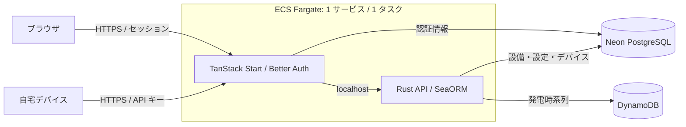

# アーキテクチャ設計

最終更新日: 2026-11-15

## 1. 目的

- 本ドキュメントは、システム構成とレイヤ責務を整理する。
- 現時点では学習・スパイク段階のため、実装済みの内容を優先して記載し、未実装部分は今後の拡張方針として分離する。

## 2. 全体構成

### 現在

Rust API は SeaORM と PostgreSQL を使用し、ローカル開発には Docker Compose を使う。TanStack Start には Better Auth のルート、画面、PostgreSQL 接続設定があるが、認証・認可の完成や本番運用は未検証である。時系列データの DynamoDB 移行は未実装。

### 将来案（未実装）

個人利用で短時間の停止を許容し、学習と低コストを優先する。

- 別コンテナを同じタスクに同居させ、Rust API は localhost で待ち受ける。独立したデプロイ・スケールが必要になれば別サービスを検討する。
- ブラウザのセッションはフロントエンドで検証し、信頼できる内部経路で Rust に利用者を伝える。デバイスの API キーは Rust 側で管理・検証する。詳細と信頼境界は [認証・デバイス設計](05_auth_device_design.md) を参照する。
- 認証と業務データは PostgreSQL、時系列は DynamoDB に置く。アクセスパターン、キー設計、保持・削除、既存データの移行と切り戻しは未設計。
- ローカルでは PostgreSQL を維持する。Better Auth のテーブルと業務テーブルの所有・マイグレーションを分離する。

### 運用・費用の検討事項

- Fargate は 0.25 vCPU / 512 MiB から測定し、2 コンテナの使用量に応じて増やす。単一タスクのためデプロイや障害時の停止を許容する。
- パブリックサブネットと IPv4 を使い ALB・NAT Gateway を省く案を検討する。HTTPS 終端、証明書更新、タスク交換時の DNS 更新、外向き通信は未設計。
- DynamoDB Standard のプロビジョンド容量と無料枠、Neon のプラン・使用量を確認する。Fargate、IPv4、ログ、バックアップ、データ転送などは別途費用がかかり得る。リージョンと実行条件を決めて見積もる。
- Neon のスリープ復帰・接続プールの再接続、バックアップと復元、権限・秘密情報の管理を検証する。

## 3. バックエンドアーキテクチャ（`backend/`）

### 3.1 レイヤ構成と責務

オニオンアーキテクチャを採用し、各層の責務を以下のように分類する。

- プレゼンテーション
    - HTTP ルーティング、リクエスト/レスポンス DTO、OpenAPI 公開
    - 入口レイヤとして use-case を呼び出す
- インフラストラクチャ
    - SeaORM モデル、Repository 実装、DB 接続、Unit of Work 実装
    - DB 依存の詳細を use-case 層から隠蔽
- インフラストラクチャ（DBマイグレーション）
    - スキーマ変更（マイグレーション）管理
- ユースケース
    - アプリケーションサービス
    - リポジトリ/Unit of Work のインターフェース定義
    - ドメインエンティティと入出力 DTO の橋渡し
- ドメイン
    - エンティティ、値オブジェクト（例: `Unit`）
    - ドメイン表現の中心

## 4. フロントエンドアーキテクチャ（`frontend/`）

### 4.1 レイヤ構成と責務

アトミックデザインを採用し、各層の責務を以下のように分類する。

- ATOMS
    - 基本的な UI コンポーネント（例: ボタン、入力フィールド、ラベル）
- MOLECULES
    - 複数の ATOMS を組み合わせたコンポーネント（例: フォーム、カード）
- ORGANISMS
    - 複数の MOLECULES を組み合わせたコンポーネント（例: ヘッダー、サイドバー）
- TEMPLATES
    - ページのレイアウトを定義するコンポーネント（例: ダッシュボードレイアウト）
- PAGES
    - ルーティングされるページコンポーネント（例: ログインページ、可視化ページ）

## 5. 今後の設計論点（未確定）

- 同一送信元の判定方法とレート制御・エラー仕様。
- セッションと内部 API の信頼境界、デバイス認証・権限、ユーザー削除時の DynamoDB データの扱い。
- 発電データの DynamoDB のキー・アクセスパターンと移行手順。
- 保護ページ導線と API ごとの認可、外部公開前の登録制限。
